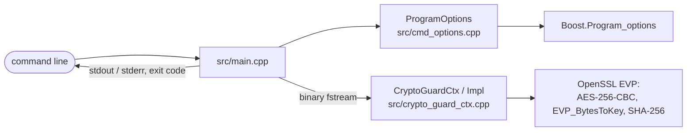

# CryptoGuard (cpp-middle-project1): documentation hub

CryptoGuard is a console program in C++23 that encrypts and decrypts a file with
AES-256-CBC under a password and prints the SHA-256 checksum of a file. OpenSSL
does the cryptography and Boost.Program_options parses the command line. It was
written for the first sprint of the Yandex Practicum "Middle C++ developer"
course (`README.md:3`); no other users are named in the repository.

The requirements reverse-engineered from the code are in [`../SPEC.md`](../SPEC.md).

## Status

- Last commit to the project's own code (`src/`, `include/`, `tests/*.cpp`,
  `CMakeLists.txt`): `11f3c7a`, 2026-11-07, "refactor(core): settle the sources
  under clang-tidy and clang-format". Later commits up to `598c511` add tooling and docs.
- Tests: 30 GoogleTest cases (17 in `tests/cmd_options_test.cpp`, 13 in
  `tests/crypo_guard_ctx_test.cpp`) and 2 pytest cases in `tests/test_manual_list.py`.
  The manual test list `tests/manual/tests.json` is empty (`docs/manual.md:36`).
- CI: five workflows in `.gitea/workflows/` for the owner's Gitea server
  (`runs-on: windows`, `.gitea/workflows/propose.yaml:14`). The repository on
  GitHub has no `.github/workflows/`: the earlier `build-and-test.yml` was deleted
  in `e6c3d62`. Whether the Gitea workflows have run for this repository is not
  recorded in the files.
- Unfinished: `.\recipe.ps1 install` does nothing, "there is no installer yet"
  (`docs/install.md:13`, `recipe.ps1:80`). The root README lists eight lab
  requirements the repository does not meet yet (`README.md:30`).

## Layout

| Path | Contents |
| --- | --- |
| `include/crypto_guard_ctx.h` | the core API: `CryptoGuardCtx`, `CryptoError`, `CryptoErrorKind` |
| `include/cmd_options.h` | `ProgramOptions`, the command-line parser |
| `src/crypto_guard_ctx.cpp` | AES-256-CBC, key derivation and SHA-256 over OpenSSL EVP, behind a pImpl |
| `src/cmd_options.cpp` | option definitions and validation over Boost.Program_options |
| `src/main.cpp` | entry point: opens files, calls the core, prints results and errors |
| `tests/cmd_options_test.cpp`, `tests/crypo_guard_ctx_test.cpp`, `tests/main.cpp` | GoogleTest suites and their `main` |
| `tests/test_manual_list.py`, `tests/manual/` | shape check of the manual test list; the manual-test page (lab tooling) |
| `CMakeLists.txt`, `CMakePresets.json`, `conanfile.py` | build, presets for Linux and MSVC, Conan dependencies |
| `scripts/build_windows.ps1` | MSVC build through Conan and the presets |
| `.devcontainer/` | Ubuntu image with g++-14 and Conan, and its Conan profile `default` |
| `.vscode/launch.json` | lldb launch entries for the dev-container build |
| `.clang-tidy`, `.clang-format` | lint and format rules used by `recipe.ps1 test` |
| `docs/install.md`, `docs/manual.md` | build routes; commands and core API |

## Architecture

`main.cpp` parses the arguments with `ProgramOptions`, opens the input and output
as binary `std::fstream` objects, and passes them to `CryptoGuardCtx`. The core
reads the input in 1024-byte chunks (`include/crypto_guard_ctx.h:13`), runs them
through OpenSSL EVP, and writes each result chunk to the output stream. The core
returns `std::expected`; `main.cpp` turns an error value into an exception and
prints it (`src/main.cpp:44-46`, `src/main.cpp:82-84`). CMake builds every source
except `main.cpp` into the static library `CryptoGuard_imp`, which the program and
the tests share (`CMakeLists.txt:62-88`). No network service or hardware is involved.



## Build and run

Three routes exist; `docs/install.md` counts the dev container as the Conan route on
Linux. None was run for this document.

1. mingw route, the one the gates use (`docs/install.md:5-13`, `recipe.ps1:53-60`):
   mingw g++ 13 or newer with its OpenSSL under `C:\ProgramData\mingw64\mingw64\opt`,
   CMake 3.30 or newer (`CMakeLists.txt:1`), Ninja, LLVM in `C:\Program Files\LLVM\bin`.
   The first build downloads Boost 1.86.0 and GoogleTest 1.13.0 by URL and SHA-256
   (`CMakeLists.txt:38-51`).
   - `.\recipe.ps1 build`: compiles `build\CryptoGuard.exe` and `build\CryptoGuard_tests.exe`.
   - `.\recipe.ps1 test`: build, ctest, clang-tidy, clang-format, core checks (`recipe.ps1:112-128`).
   - `.\recipe.ps1 run <arguments>`: build, then run `build\CryptoGuard.exe` with the arguments (`recipe.ps1:88-92`).
2. MSVC route: Visual Studio 2022 with the C++ workload, CMake, Ninja, Conan 2
   (`docs/install.md:17`). Conan installs `openssl/3.1.1`, `boost/1.86.0`,
   `gtest/1.13.0` (`conanfile.py:12-14`).
   - `powershell -ExecutionPolicy Bypass -File scripts\build_windows.ps1` (`docs/install.md:20`).
   - `... scripts\build_windows.ps1 -BuildType Debug -Clean` (`scripts/build_windows.ps1:42`).
3. Linux dev container: `.devcontainer/Dockerfile` installs g++-14, cmake, make and
   Conan; the `linux-default` preset expects `conan install . -s build_type=Debug --build=missing`
   first (`CMakePresets.json:12`), then `cmake --preset linux-default`.

## Configuration

The program reads no environment variables and no configuration file; everything
comes from the command line (`src/cmd_options.cpp:13-17`).

| Name | Where | Meaning | Default |
| --- | --- | --- | --- |
| `-c`, `--command` | CLI | `encrypt`, `decrypt` or `checksum` | required |
| `-i`, `--input` | CLI | input file path | required |
| `-o`, `--output` | CLI | output file path, for `encrypt` and `decrypt` | required for those |
| `-p`, `--password` | CLI | password, for `encrypt` and `decrypt` | required for those |
| `-h`, `--help` | CLI | prints the option list, then exits with code 1 | - |
| `CRYPTO_GUARD_FETCH_DEPENDENCIES` | CMake option | fetch Boost and GoogleTest instead of `find_package` | `OFF` (`CMakeLists.txt:19`); `recipe.ps1` sets `ON` |
| `OPENSSL_ROOT_DIR`, `OPENSSL_USE_STATIC_LIBS` | CMake cache | set by `recipe.ps1:56` to the mingw OpenSSL, static | - |
| `-BuildType`, `-Clean`, `-SkipTests` | `scripts/build_windows.ps1:46-53` | Release or Debug; delete the build folder first; skip ctest | `Release`, off, off |
| `LAB_SHARE` | environment | target folder of `recipe.ps1 publish` (`recipe.ps1:95`) | unset: `publish` fails |

## Usage

From `README.md:5-9`, with the built program:

```powershell
CryptoGuard.exe -i input.txt     -o encrypted.txt -p 1234 --command encrypt
CryptoGuard.exe -i encrypted.txt -o decrypted.txt -p 1234 --command decrypt
CryptoGuard.exe -i decrypted.txt --command checksum
```

Each command prints one success line to stdout; `checksum` adds `Result: <64 hex digits>`
(`src/main.cpp:48`, `:60`, `:73`). Any failure prints `Error: <reason>` to stderr
and exits with 1 (`src/main.cpp:82-84`). Through the recipe, pass the long option
names: `.\recipe.ps1 run --input input.txt --command checksum` (see limitation 6).

The core can be used from C++ on any `std::iostream`; `docs/manual.md:21-32` has an example.

## Testing

`.\recipe.ps1 test` runs `ctest --test-dir build --output-on-failure --no-tests=error`
(`recipe.ps1:118`). ctest holds `CryptoGuard_Tests` (all GoogleTest cases) and, only
when `CRYPTO_GUARD_FETCH_DEPENDENCIES` is on, `manual_list` (pytest over
`tests/test_manual_list.py`) (`CMakeLists.txt:89-98`). On the MSVC route
`scripts/build_windows.ps1:280` runs `ctest --preset <preset>` without `manual_list`.

Coverage: `ProgramOptions` parsing (aliases, missing values, unknown command,
repeated option, help, no arguments); `CryptoGuardCtx` encrypt/decrypt round trip,
wrong password, empty or malformed ciphertext, failed streams, and SHA-256 of a fixed
string. `src/main.cpp` (file opening, the same-file check, messages, exit codes) has no test.

## Known limitations and problems

1. Key and IV come from the password with `EVP_BytesToKey`, SHA-256, one iteration
   and a salt hard-coded in `src/crypto_guard_ctx.cpp:165-169`; the password is a
   command-line argument. `docs/manual.md:17` states the tool suits a course exercise,
   not secrets that matter. Inference from the same lines: equal password and equal
   input give equal ciphertext.
2. No MAC is computed (`src/crypto_guard_ctx.cpp:109-154` uses only `EVP_Cipher*`), so
   a wrong password is detected only when OpenSSL's final-block check fails. Inference;
   one wrong-password case is tested.
3. The output file is opened, and so truncated, before the transform; after an error it
   may hold a partial result (`src/main.cpp:41-42`, `docs/manual.md:15`).
4. The same-file check compares the two path strings (`src/main.cpp:34`); two
   spellings of one path are not caught. Inference from code, not run.
5. `--help` prints the options and then reports `Error: No arguments!` with exit code 1
   (`src/cmd_options.cpp:40-43`, `src/main.cpp:82-84`). From code, not run. Messages
   carry typos: `Parsingrror` (`src/cmd_options.cpp:35`), `successfuly` (`src/main.cpp:48`).
6. `recipe.ps1` takes the program's arguments through `ValueFromRemainingArguments`
   (`recipe.ps1:5-6`). Measured with a copy of that parameter block under Windows
   PowerShell 5.1: `-i` and `-o` stop with "parameter name is ambiguous", and `-p 1234`
   disappears from the arguments (it binds to the common parameter `-PipelineVariable`).
   `-c`, `-h` and the long names pass through.
7. Test `Decrypt_EmptyPassword_Error` decrypts 27 bytes of plain text, which fails as a
   malformed ciphertext whatever the password; the core does not reject an empty
   password. No test input exceeds the 1024-byte chunk. Inference from
   `tests/crypo_guard_ctx_test.cpp:68-73` and `src/crypto_guard_ctx.cpp:109-176`.
8. `recipe.ps1` is Windows-only and hard-codes the mingw and LLVM folders (`recipe.ps1:49`, `:56`).
9. The lab-requirements link in `README.md:30` points to `127.0.0.1:3000`, which does not
   resolve for readers of the GitHub repository.
10. The dev container installs `cmake` from apt without a version while `CMakeLists.txt:1`
    requires 3.30; whether that route still configures is not verified, and no gate
    builds it (`docs/install.md:23`).

## Repository tooling

The repository carries the lab tooling of
[repo-quality-template](https://github.com/IGORSVOLOHOVS/repo-quality-template).
`README.md:28-30` states compliance with revision 4.0.0 of the lab requirements,
except R-02, R-09, R-12, R-13, R-14, R-37, R-41 and R-42 (issues #8-#15 on the lab server).
Specific here:

- `recipe.ps1:11-22`: `$Name` `cpp-middle-project1`, `$Code` `cmp`, `$Version` `1.0.0`;
  `$Needs` and `$Tools` empty; no `$App` ("A console tool: no $App, no installer",
  `recipe.ps1:18`); `$Provides` is the two core files `include/crypto_guard_ctx.h` and
  `src/crypto_guard_ctx.cpp`.
- Verbs that act: `build`, `run`, `test` (as above), `publish` (copies `$Provides` to
  `$env:LAB_SHARE\needs\cpp-middle-project1\v1.0.0`), `info`, `clean` (removes `dist`,
  `build`, `out`). `install` and `uninstall` print "nothing to ..." (`recipe.ps1:75-129`).
- `test` adds two project checks: `git grep` over `$Provides` for lock words and for
  `throw|try|catch`; a hit fails the verb (`recipe.ps1:62-71`, `:126-127`).
- Deviations: `.claude/.env` is gitignored and no key is committed (`CLAUDE.md` rule 4,
  `.gitignore`); pre-lab history kept as it was (`CLAUDE.md`, "Where this repository is
  deliberately relaxed").
- Project files outside the template: `scripts/build_windows.ps1`, `.devcontainer/`,
  `.vscode/launch.json`, `conanfile.py`, `CMakePresets.json`.

## Related documents

- [`../README.md`](../README.md): project overview
- [`../SPEC.md`](../SPEC.md): requirements specification
- [`install.md`](install.md): build routes and prerequisites
- [`manual.md`](manual.md): options, core API, tests
- [`../CLAUDE.md`](../CLAUDE.md): repository rules
- [`../CONTRIBUTING.md`](../CONTRIBUTING.md): contribution steps
- [`../LICENSE`](../LICENSE): MIT

## About this document

Written 2026-11-18 from commit `598c511`.

Commands run: `git status -sb`, `git log` (overall, per path, `--diff-filter=D`),
`git ls-files`, `git show --stat 10b662e`, `git remote -v`, `git branch -a`, `git grep`
over the core for `throw|try|catch`, lock words and TODO (no hits);
`sha256sum` of the test string, which matches the expected value in
`tests/crypo_guard_ctx_test.cpp:107`; `python -m pytest tests/test_manual_list.py -q -p no:cacheprovider`
(2 passed); `powershell -File recipe.ps1 info` (exit 0); a copy of the `recipe.ps1`
parameter block in a temporary folder outside the repository, for limitation 6.

Not run: `recipe.ps1 build`, `test`, `run` (they download Boost and GoogleTest and
build longer than allowed here), `scripts/build_windows.ps1`, ctest, clang-tidy,
clang-format, and the CryptoGuard program itself. Behaviour of the program is
described from the source.
